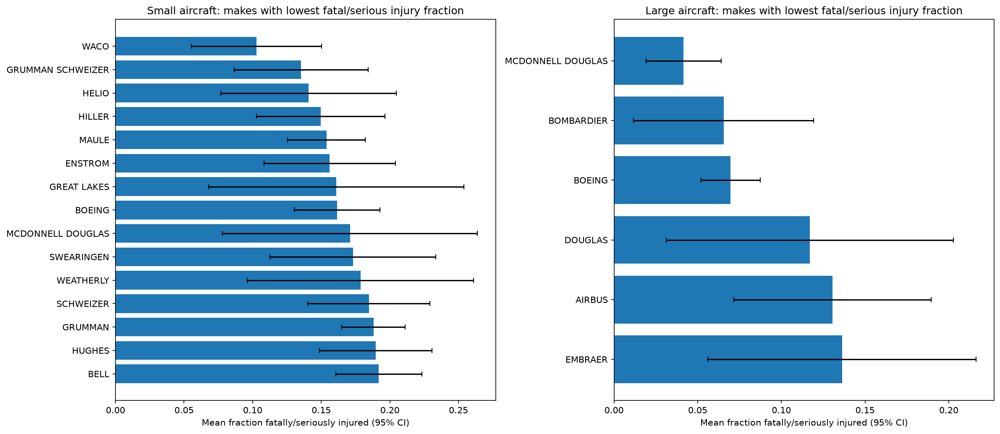
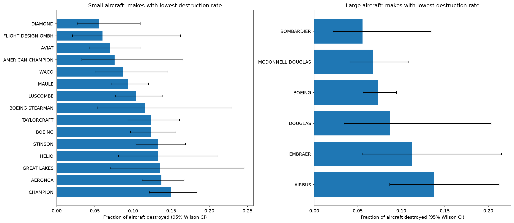
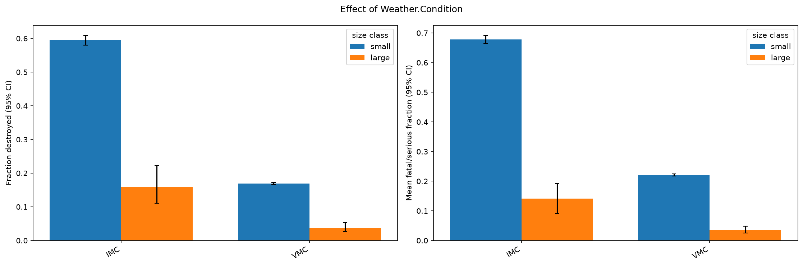
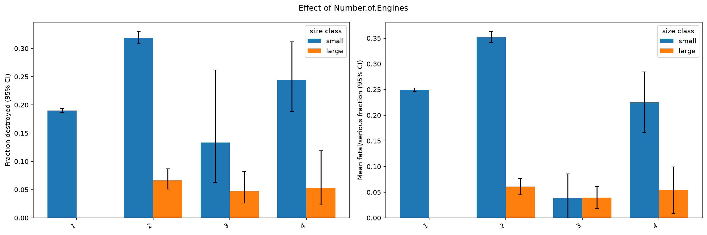

# Aviation Accident Analysis

## Overview

This project looks at NTSB aviation accident records to help an airline and aircraft insurer decide which airplanes are the safest bets. The client asked two things. First, which makes and models are rarely destroyed and rarely cause fatal or serious injuries when an accident does happen. Second, which general conditions, such as weather or engine count, make accidents worse.

The raw data covers accidents from 1948 onward. After filtering, the analysis uses events from 1983 to 2022. Small aircraft and larger passenger aircraft are analysed separately, since they are used very differently and it would not be fair to rank a Cessna against a Boeing.

## The business question

An insurer or airline cares about two outcomes once an accident has occurred: was the aircraft a total loss, and were people badly hurt? So every result here is about severity, not about how often accidents happen. That limit comes up again in the limitations section.

## Data

The raw file is the NTSB Aviation Accident Database from Kaggle ("Aviation Accident Database & Synopses"). Each row is one aircraft involved in one event, with details like the make, model, date, weather, number of engines, injury counts and the damage to the aircraft. A few events involve two aircraft, so some event IDs repeat.

## Repository contents

| File | What it does |
|---|---|
| Aviation_Accidents_Cleaning.ipynb | Loads the raw data, cleans it, builds the injury and damage measures, and saves aviation_cleaned.csv |
| Aviation_Accidents_Data_Analysis.ipynb | Compares makes and models, tests the weather and engine factors, and discusses the results |
| aviation_cleaned.csv | Output of the cleaning notebook, used by the analysis notebook |
| data/AviationData.csv | The raw NTSB data (download it from Kaggle, it is not included in the repo) |
| images/ | Charts saved by the analysis notebook |
| LICENSE | License |

## How to run

1. Install pandas, numpy, matplotlib, seaborn, scipy and jupyter.
2. Download the raw file from Kaggle and save it as data/AviationData.csv. Check the capital letters in the name.
3. Run Aviation_Accidents_Cleaning.ipynb from top to bottom. It writes aviation_cleaned.csv.
4. Run Aviation_Accidents_Data_Analysis.ipynb from top to bottom. It writes the charts to images/.

Both notebooks use relative paths, so they need to sit in the project root, next to the data folder.

## Cleaning steps

- Dates are converted to real dates and only events from 1983 onward are kept. This assumes a make or model stays in service for about 40 years at most.
- Only professionally built aircraft are kept. Rows where this is blank are dropped because we cannot confirm how the plane was built.
- Only airplanes are kept. The category is often blank in older records, so where it is missing but the engine type is a fixed-wing one, the record is treated as an airplane.
- Total occupants is fatal plus serious plus minor plus uninjured counts. This includes crew, because the data does not separate crew from passengers. Rows with no injury information, or with zero occupants, are dropped.
- Damage is cleaned and a destroyed column is created, equal to 1 when the aircraft was destroyed and 0 otherwise. Rows with unknown damage are dropped.
- Make names are uppercased, stripped of punctuation and company suffixes, and a manual map merges spelling variants of the same manufacturer (for example "Beechcraft" and "Beech").
- Model names are uppercased and stripped of spaces and hyphens so that "737-200" and "737 200" match. Because the same model label can appear under different makes, each plane type is the make and model joined together.
- Weather, engine type, number of engines, purpose of flight and phase of flight are standardised. "Unknown" values become missing. An engine count of zero is treated as missing for an airplane.
- Columns that are more than half empty are dropped, except the ones needed for the analysis.

After cleaning there are 60,814 accidents.

## Method

Injury severity is measured as the fraction of people on board who were fatally or seriously injured: (fatal + serious) divided by total occupants. Damage is the share of accidents where the aircraft was destroyed.

Aircraft are split into small and large. A plane type counts as large if the median number of people on board across its accidents is at least 20. The median is used instead of the maximum because some records are plainly wrong, for instance 90 occupants on a four-seat Piper. This gives about 1,300 large-aircraft accidents and about 59,500 small-aircraft accidents.

To avoid being fooled by small samples, makes need at least 30 accidents and plane types at least 10 within their size class. Every rate has a 95% confidence interval, and the shortlists are ranked using the upper end of the interval, so a type with only a handful of accidents does not look better than it deserves. Weather and engine count are compared within each size class using chi-square tests for destruction and Kruskal-Wallis tests for the injury fraction.

## Findings

### Small aircraft

Maule has the strongest evidence among small aircraft. Across 567 accidents its injury fraction is 0.154 (95% CI 0.125 to 0.182) and 9.3% of its aircraft were destroyed. Waco, Helio and Diamond also have low rates, but on fewer accidents. At model level, the Cessna 180, 180A and 185 and the Piper PA-18 and PA-20 stand out, and all have large accident counts.

### Larger passenger aircraft

McDonnell Douglas has an injury fraction of 0.042 with 6.7% destroyed over 223 accidents. Boeing comes in at 0.070 with 7.3% destroyed over 711 accidents. Bombardier looks promising but is based on only 72 accidents. Only 35 large-aircraft types have 10 or more accidents and just 2 have 30 or more, so individual models cannot be separated with confidence. The recommendation is therefore made at manufacturer level.

### Weather

Accidents in instrument conditions (IMC) are much more severe than in visual conditions (VMC). Small aircraft were destroyed in 59.5% of IMC accidents and 16.9% of VMC accidents. For large aircraft the figures are 15.9% and 3.7%. The difference is statistically clear in both size classes.

### Number of engines

Among small aircraft, twin-engine accidents are worse than single-engine ones: 31.9% destroyed against 19.0%, and an injury fraction of 0.352 against 0.249. Among large aircraft, two, three and four-engine types do not differ significantly (p = 0.52 for destruction).

## Recommendations

For small aircraft, the evidence favours Maule among makes, and the Cessna 180 and 185 and Piper PA-18 and PA-20 among models. For larger passenger aircraft, McDonnell Douglas and Boeing have the best combination of low rates and enough data. In both groups, accidents in instrument conditions are the most dangerous, and for small aircraft twin-engine types do worse than single-engine ones.

## Limitations

- The data only contains accidents and has no flight hours. Every rate here is "given that an accident happened". It says nothing about how often each make has accidents in the first place.
- Injury counts include crew.
- The size classification is based on occupants, which is not perfect. A few freighter types (for example the Boeing 747 and the MD-11F) have crew-only records and end up in the small group, and a handful of bad records exist in the data. A manual list of exceptions would fix the known cases.
- Low severity is not the same as safe. Some types, like bush planes, have many minor taxi and landing accidents that pull their averages down, and a lot of large-jet accidents are turbulence injuries rather than crashes.
- The cleaned data still contains some incident records as well as accidents.
- The findings are associations, not proof of cause. Twin-engine aircraft, for example, tend to be flown in harder conditions than single-engine ones.

## Next steps

- Add flight hours or fleet size from another source, so that accident rates and not just severity can be compared.
- Fix the size classification for cargo aircraft and re-run the analysis.
- Narrow the small-aircraft ranking to makes the client could realistically buy or insure.
- Look at the phase of flight and the purpose of the flight as extra factors.
